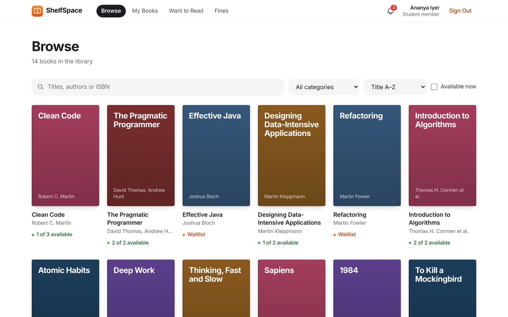
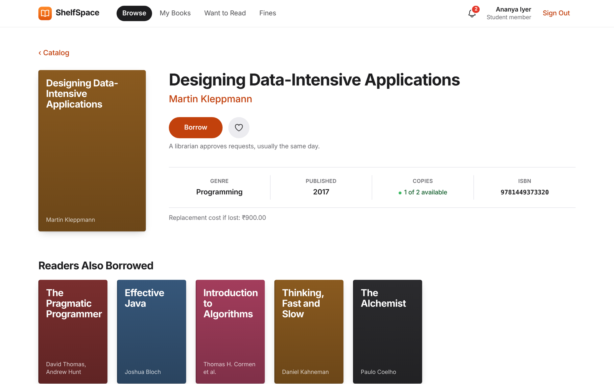
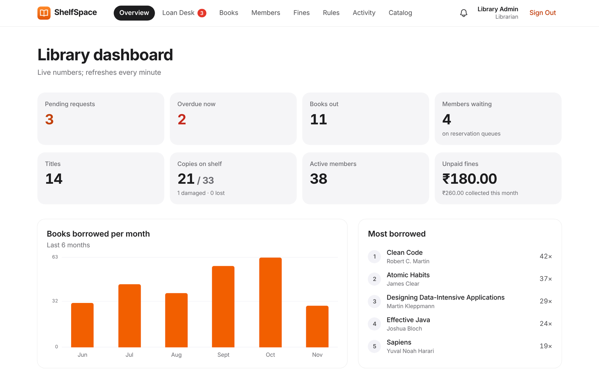
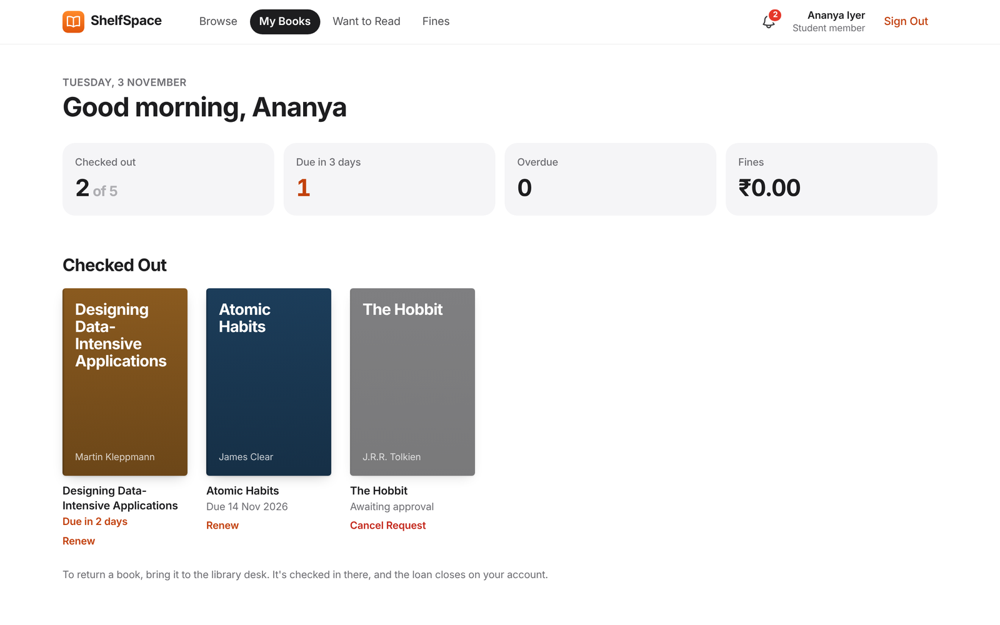
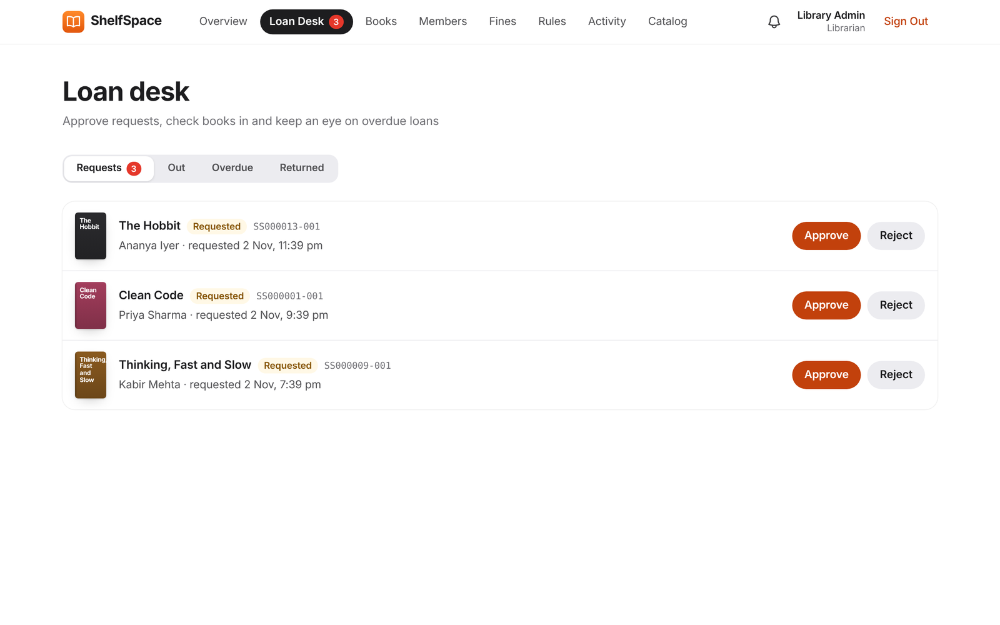
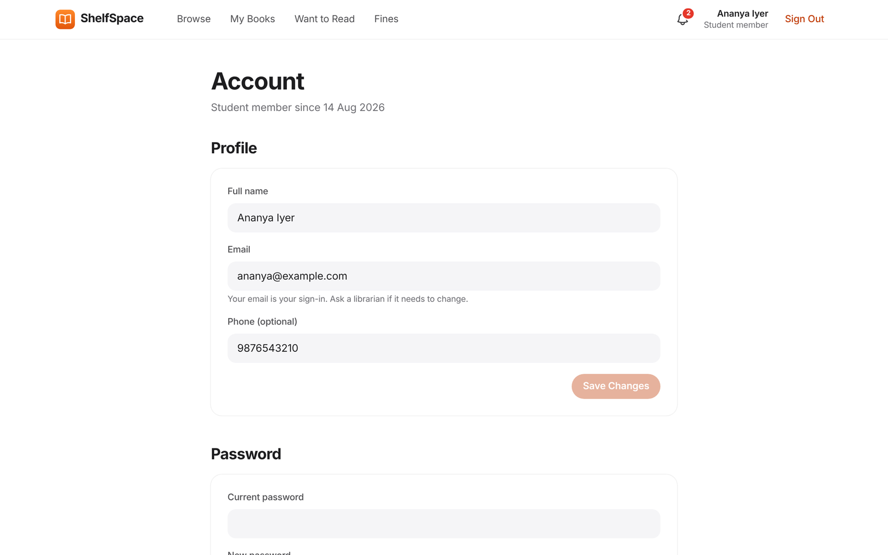
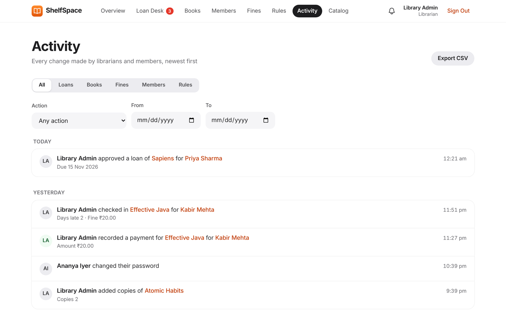
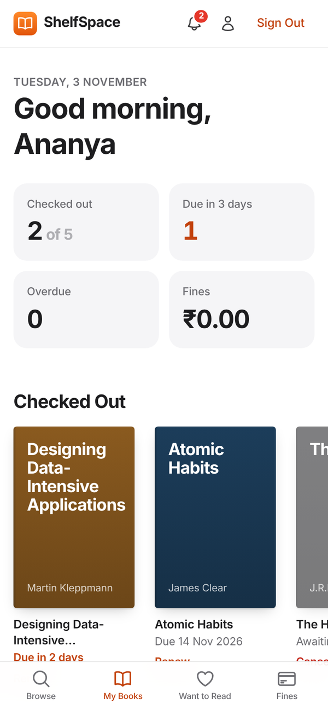
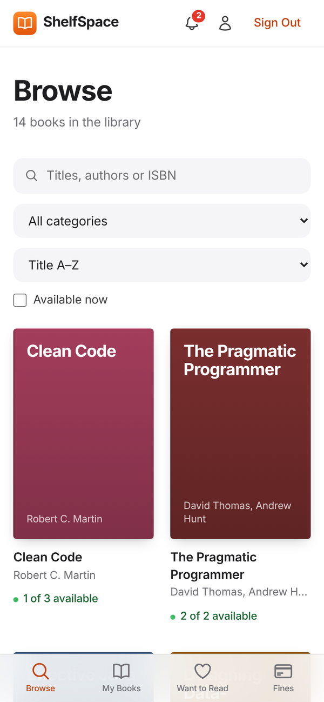
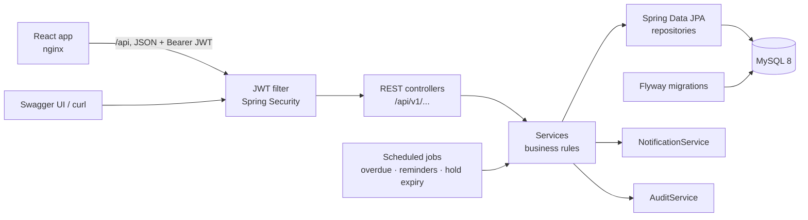

# ShelfSpace

[](https://github.com/Hemant-Mhalsekar/ShelfSpace/actions/workflows/ci.yml)


[](https://shelf-space-pi.vercel.app)


A full-stack library management system: a Spring Boot REST API and a React web app. Librarians manage the catalog, members and loans. Members search, borrow, renew and reserve books. Fines, waiting lists, reminders and dashboards run automatically.

**Live demo: https://shelf-space-pi.vercel.app**. Log in with the *Member* or *Librarian* demo buttons. The API runs on a free host, so if nobody has used it for a while, the first load can take a couple of minutes.



## Screenshots

| Members | Librarians |
|---|---|
| **Book page** with Borrow, Want to Read and "Readers also borrowed"<br> | **Dashboard** with live numbers, a 6-month chart and the most borrowed books<br> |
| **My Books**: due dates, renewals, the waiting list and suggestions<br> | **Loan desk**: approve or reject requests, check books in<br> |
| **Account**: profile, password, sign out other devices, membership limits<br> | **Activity**: the audit log in plain sentences, filterable, with CSV export<br> |

<p align="center">
  
  &nbsp;&nbsp;
  
  <br><em>On phones, members get an app-style tab bar.</em>
</p>

<sub>Screenshots use sample data.</sub>

## Features

| Members | Librarians |
|---|---|
| Catalog search with filters, book page with Borrow / Reserve | Dashboard: live stats, top books, 6-month chart |
| Dashboard: loans, due dates, overdue fines, reservations with queue position | Loan desk: approve/reject requests, check in, mark lost |
| Renew, cancel requests and reservations | Books: add, edit, add copies, mark copies damaged/lost |
| Notifications with unread badge; fines | Members: search, profile, tier changes, suspend/reactivate, password reset |
| Wishlist and recommendations | Fines (pay/waive) and an editor for borrowing rules |
| Account: profile, password, sign out other devices, membership limits | Activity: the audit log in plain sentences, filterable, with CSV export |

**Under the hood**

- **No double booking:** optimistic locking on each physical copy; a test fires 10 simultaneous requests at the last copy and exactly one wins.
- **Rules as data:** loan limits, loan length, fines, renewals and holds are per-tier rows that librarians edit, so a rule change needs no redeploy.
- **Fair waiting list:** a first-come queue with 48-hour holds; every freed copy goes through one method, so nobody jumps the queue.
- **Background jobs:** nightly overdue marking, due-tomorrow reminders and hold expiry.
- **Sessions you can end:** rotating single-use refresh tokens; a password change or suspension signs the person out everywhere. Sign-in is rate limited.
- **Audited:** every librarian action is logged, and the log can be filtered and exported.

## Tech stack



**Backend:** Java 21 · Spring Boot 3.3 · Spring Security (JWT, method-level roles) · Spring Data JPA / Hibernate 6 · MySQL 8 · Flyway · springdoc OpenAPI · JUnit 5 · Testcontainers

**Frontend:** React 19 · TypeScript · Vite · Tailwind CSS 4 · React Router · TanStack Query

**Ops:** Docker (API + nginx-served web app) · GitHub Actions

## Run it locally

The only prerequisite is Docker.

```bash
git clone https://github.com/Hemant-Mhalsekar/ShelfSpace.git
cd ShelfSpace
docker compose up --build
```

Open **http://localhost:3000** and use the *Member* or *Librarian* demo button. The API's Swagger UI is at http://localhost:8080/swagger-ui.html.

| Role | Email | Password |
|---|---|---|
| Librarian | `admin@shelfspace.dev` | `Admin@12345` |
| Member | `member@shelfspace.dev` | `Member@12345` |

## Tests

```bash
cd backend && ./mvnw test   # 157 backend tests; needs Docker for the MySQL integration tests
cd frontend && npm test     # 47 frontend component tests; no backend needed
```

There's also a [Playwright end-to-end test](e2e/README.md) that drives a real browser through borrowing, approving and checking in a book. All three run in GitHub Actions on every push.

## Documentation

- [API reference](docs/api.md): every endpoint, a 2-minute curl walkthrough, session security, default borrowing rules
- [Architecture and design](docs/architecture.md): design decisions, data model, project structure
- [Testing](docs/testing.md): what the backend and frontend suites cover
- [Deploying](docs/deployment.md): free hosting on Vercel, Render and Aiven
- [Development](docs/development.md): running from source, frontend dev server, branching
