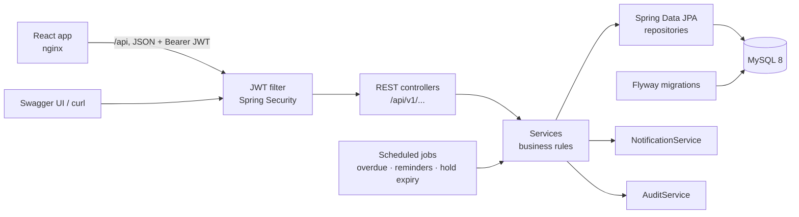
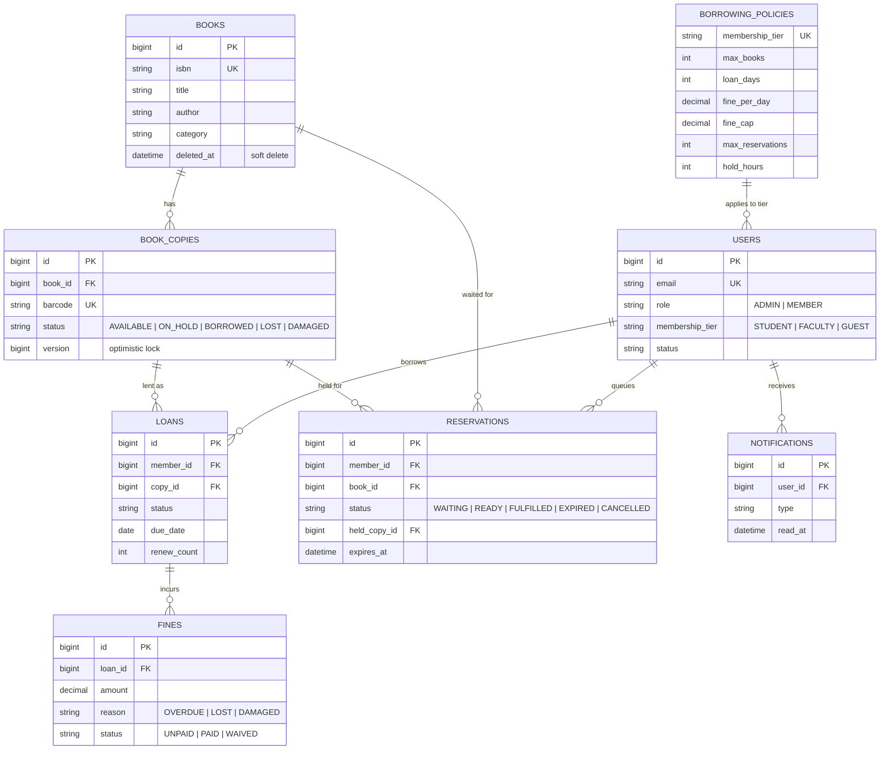

# ShelfSpace

[](https://github.com/Hemant-Mhalsekar/ShelfSpace/actions/workflows/ci.yml)


[](https://shelf-space-pi.vercel.app)


A full-stack library management system: a Spring Boot REST API and a React web app. Librarians manage the catalog, members and loans. Members search, borrow, renew and reserve books. Fines, waiting lists, reminders and dashboards run automatically.

**Live demo: https://shelf-space-pi.vercel.app**. Log in with the *Member* or *Librarian* demo buttons. The API runs on a free host, so if nobody has used it for a while, the first load can take a couple of minutes.

## Highlights

- **No double booking under load.** Optimistic locking (`@Version`) on each physical copy. A test fires 10 simultaneous requests at the last copy and asserts exactly one wins.
- **Loan state machine.** `REQUESTED → APPROVED → ISSUED → OVERDUE / RETURNED / LOST`, with invalid transitions rejected in one place.
- **Rules as data.** Book limits, loan length, fine rates, renewals, reservation limits and hold time live in a `borrowing_policies` table per membership tier, so changing a rule needs no redeploy.
- **Fair waiting list.** A FIFO reservation queue with 48-hour holds. Every freed copy goes through one method, so nobody can jump the queue.
- **Background jobs.** Nightly overdue marking, de-duplicated due-tomorrow reminders, and hold expiry every 15 minutes.
- **Fine ledger.** Fines are capped per tier and can be paid or waived (waiving needs a reason). Every admin action is audited.
- **Dashboards.** Admins see inventory, circulation, fines, the top 5 books and a 6-month trend. Members see due dates, fines, reservations and alerts.
- **Tested against real MySQL.** 88 tests, including Testcontainers integration tests, run in GitHub Actions on every push.

## Architecture



The code is a **modular monolith**: one deployable app, with packages split by feature (`auth`, `catalog`, `circulation`, `reservation`, `fine`, `notification`, `dashboard`). Each module owns its entities, repositories, services and controllers. That keeps boundaries clear without the operational cost of microservices; a module could be extracted later if it ever needed to scale on its own.

## Tech stack

**Backend:** Java 21 · Spring Boot 3.3 · Spring Security (JWT, method-level roles) · Spring Data JPA / Hibernate 6 · MySQL 8 · Flyway · springdoc OpenAPI · JUnit 5 · Testcontainers

**Frontend:** React 19 · TypeScript · Vite · Tailwind CSS 4 · React Router · TanStack Query

**Ops:** Docker (API + nginx-served web app) · GitHub Actions

## Quick start

The only prerequisite is Docker.

```bash
git clone https://github.com/Hemant-Mhalsekar/ShelfSpace.git
cd ShelfSpace
docker compose up --build
```

- **Web app: http://localhost:3000.** Use the *Member* or *Librarian* demo buttons on the login page.
- Swagger UI: http://localhost:8080/swagger-ui.html (click **Authorize** and paste a token)
- Health: http://localhost:8080/actuator/health

### What's in the web app

| Members | Librarians |
|---|---|
| Catalog search with filters, book page with Borrow / Reserve | Dashboard: live stats, top books, 6-month chart |
| Dashboard: loans, due dates, overdue fines, reservations with queue position | Loan desk: approve/reject requests, check in, mark lost |
| Renew, cancel requests and reservations | Books: add, edit, add copies, mark copies damaged/lost |
| Notifications with unread badge; fines | Members: search, profile, tier changes, suspend/reactivate, password reset |
| Wishlist and recommendations | Fines (pay/waive) and an editor for borrowing rules |
| Account: profile, password, sign out other devices, membership limits | Activity: the audit log in plain sentences, filterable, with CSV export |

Frontend development: see [`frontend/README.md`](frontend/README.md). In short: `cd frontend && npm install && npm run dev`, with the API on port 8080.

To run from source instead, you need JDK 21, plus Docker for the database and tests:

```bash
docker compose up -d mysql
./mvnw spring-boot:run      # or: mvn spring-boot:run
./mvnw test                 # 134 tests; integration tests start their own MySQL
```

> JDK 22+ isn't supported yet: Lombok, used by Spring Boot 3.3, fails to compile on it. With jEnv, the included `.java-version` selects 21 automatically.

## Try it in 2 minutes

With the app running, paste this into a terminal. It needs `jq`; run it on a fresh database, because the ISBN must be unique.

```bash
API=http://localhost:8080/api/v1
login() { curl -s -X POST $API/auth/login -H 'Content-Type: application/json' \
  -d "{\"email\":\"$1\",\"password\":\"$2\"}" | jq -r .accessToken; }
ADMIN=$(login admin@shelfspace.dev Admin@12345)
MEMBER=$(login member@shelfspace.dev Member@12345)

# Admin adds a book with one copy
BOOK=$(curl -s -X POST $API/books -H "Authorization: Bearer $ADMIN" -H 'Content-Type: application/json' \
  -d '{"title":"Clean Code","author":"Robert C. Martin","isbn":"978-0-13-235088-4","category":"Programming","publicationYear":2008,"replacementCost":599,"initialCopies":1}' | jq .id)

# Member searches, then requests it
curl -s "$API/books?q=clean" -H "Authorization: Bearer $MEMBER" | jq '.content[] | {title, availableCopies}'
LOAN=$(curl -s -X POST $API/loans -H "Authorization: Bearer $MEMBER" -H 'Content-Type: application/json' \
  -d "{\"bookId\": $BOOK}" | jq .id)

# Librarian approves; the due date is set from the member's policy
curl -s -X POST $API/loans/$LOAN/approve -H "Authorization: Bearer $ADMIN" | jq '{status, dueDate}'

# Member dashboard
curl -s $API/dashboard/me -H "Authorization: Bearer $MEMBER" | jq .summary

# Book comes back (a fine is charged automatically if late)
curl -s -X POST $API/loans/$LOAN/return -H "Authorization: Bearer $ADMIN" | jq '{status: .loan.status, overdueDays, fineCharged}'
```

## Demo accounts

Created automatically on startup when `SEED_ENABLED=true` (the default for local runs):

| Role | Email | Password |
|---|---|---|
| Admin | `admin@shelfspace.dev` | `Admin@12345` |
| Member | `member@shelfspace.dev` | `Member@12345` |

Set `SEED_ENABLED=false` and a strong `JWT_SECRET` in any real deployment.

## Design decisions

| Decision | Why |
|---|---|
| **Book vs. copy** | A title can have many physical copies, each with its own barcode and status. Loans point at a copy, so you always know which item is where and which one is damaged or lost. |
| **Optimistic locking** on copies | Conflicts are rare, so there's no need to lock rows on every read. When two requests do race, the second fails cleanly with `409` instead of double-booking. |
| **Rules in `borrowing_policies`** | Librarians change limits, not developers. New rules arrive as Flyway migrations; V3 added reservation limits and hold time to existing tiers. |
| **One release point for copies** | `ReservationService.releaseCopy` is the only way a copy becomes free, so the waiting list can't be bypassed by any of the six code paths that free a copy. |
| **Flyway owns the schema** | Hibernate only validates (`ddl-auto: validate`). Every schema change is a reviewed, versioned SQL file. |
| **Injected `Clock`** | All date logic (due dates, fines, holds) reads time through one bean, so time-based behaviour is testable. |
| **JWT with revocation** | Short-lived access tokens (15 min) and rotating refresh tokens (7 days). No server sessions; a per-user token version lets a password change or suspension sign someone out everywhere at once. |
| **Consistent errors** | Every error, including 401/403 from the security layer, uses the same JSON shape. Bad sort fields and malformed JSON return 400, never 500. |
| **No N+1 queries** | Search pages fetch copy counts in one grouped query; loan and fine lists use entity graphs. |

## Data model



An `audit_log` table also records admin actions: who did what, to which entity, and when.

## API reference

The full interactive docs are in Swagger UI. In summary:

### Authentication

ShelfSpace uses stateless JWT authentication.

| Endpoint | Auth | Description |
|---|---|---|
| `POST /api/v1/auth/register` | Public | Create a member account |
| `POST /api/v1/auth/login` | Public | Returns an access token (15 min) and a refresh token (7 days) |
| `POST /api/v1/auth/refresh` | Public | Swap a refresh token for a new pair. Each refresh token works once |
| `POST /api/v1/auth/logout` | Public | Ends the sign-in this refresh token belongs to |
| `GET /api/v1/auth/me` | Bearer token | Current user's profile |

Send the access token on every request as `Authorization: Bearer <token>`. In Swagger UI, click **Authorize** and paste the token.

### Your account

| Endpoint | Auth | Description |
|---|---|---|
| `PUT /api/v1/account/profile` | Bearer token | Update your name and phone (email can't be changed) |
| `POST /api/v1/account/password` | Bearer token | Change your password; needs the current one, and the new one must differ. Signs out other devices and returns new tokens for this one |
| `POST /api/v1/account/sign-out-everywhere` | Bearer token | Signs out every other device; returns new tokens for this one |

Passwords are 8 to 72 characters with at least one letter and one digit. Changes are written to the audit log.

### Session security

- **Revocable tokens.** Every token carries the user's `token_version`. Changing a password, a librarian reset, suspension or "sign out other devices" bumps it, and every older token stops working on the next request (one primary-key lookup per request).
- **Refresh token rotation.** Each refresh token works once and is tracked in `refresh_tokens`. If a used one comes back, it was copied, so that whole sign-in is revoked. Expired rows are deleted nightly.
- **Sign-in lockout.** 5 wrong passwords for one email from one IP lock that pair for 15 minutes (`429` with `Retry-After`). Locking per email + IP stops guessing without letting a stranger lock the real owner out.
- **Per-IP limit.** Register, login and refresh are capped at 30 requests per IP per minute (`AUTH_RATE_LIMIT`, `0` turns it off).
- Counters live in memory, which suits a single instance. Running several would need a shared store such as Redis.

### Catalog

| Endpoint | Who | Description |
|---|---|---|
| `GET /api/v1/books?q=&category=&availableOnly=&page=&size=&sort=` | Logged in | Search by title, author or ISBN. Paged; sortable by title, author, category, publicationYear, createdAt |
| `GET /api/v1/books/{id}` | Logged in | Book details with total and available copies |
| `GET /api/v1/books/categories` | Logged in | All categories |
| `POST /api/v1/books` | Admin | Add a book, optionally with `initialCopies` |
| `PUT /api/v1/books/{id}` | Admin | Update a book |
| `DELETE /api/v1/books/{id}` | Admin | Soft delete; refused while copies are borrowed/on hold or members are waiting |
| `GET /api/v1/books/{id}/copies` | Admin | List physical copies |
| `POST /api/v1/books/{id}/copies` | Admin | Add copies; barcodes are generated (`SS000012-003`) |
| `PATCH /api/v1/copies/{id}/status` | Admin | Mark a copy AVAILABLE, DAMAGED or LOST |

Design notes:
- **ISBN validation** checks the ISBN-10/13 check digit and stores ISBNs without hyphens, so `978-0-13-235088-4` and `9780132350884` count as the same book.
- **No N+1 queries:** copy counts for a whole search page come from one grouped query.
- **Copy states owned by circulation:** `BORROWED` and `ON_HOLD` are only set by the loan and reservation flows, never by hand.
- **Audit trail:** every admin change is written to `audit_log` in the same transaction.

### Borrowing and fines

```
Member requests ─▶ REQUESTED (copy ON_HOLD)
                    ├─ member cancels ─▶ CANCELLED
                    ├─ admin rejects  ─▶ REJECTED
                    └─ admin approves ─▶ ISSUED (copy BORROWED, due date set)
                                          ├─ renew  ─▶ due date + loan period
                                          ├─ return ─▶ RETURNED (+ overdue fine)
                                          └─ lost   ─▶ LOST (+ replacement cost)
```

| Endpoint | Who | Description |
|---|---|---|
| `POST /api/v1/loans` | Member | Request a book; one copy is held |
| `GET /api/v1/loans/me?status=` | Member | My current loans and history, with live overdue days and fine |
| `GET /api/v1/loans/{id}` | Owner/Admin | One loan (others get 404) |
| `POST /api/v1/loans/{id}/cancel` | Owner | Cancel a pending request |
| `POST /api/v1/loans/{id}/renew` | Owner/Admin | Extend the due date |
| `GET /api/v1/loans?memberId=&status=` | Admin | All loans; `status=REQUESTED` is the approval queue |
| `POST /api/v1/loans/{id}/approve` and `/reject` | Admin | Decide a request |
| `POST /api/v1/loans/{id}/return` and `/lost` | Admin | Close a loan and charge fines |
| `GET /api/v1/fines/me` | Member | My fines and total owed |
| `GET /api/v1/fines?memberId=&status=` | Admin | All fines |
| `POST /api/v1/fines/{id}/pay` and `/waive` | Admin | Collect or waive (waive needs a reason) |

**Borrowing rules**, checked in order, all read from the member's tier in `borrowing_policies`:
1. Account is active.
2. No books past their due date.
3. Unpaid fines are not above the tier limit.
4. Active loans are under the tier's book limit.
5. They don't already have this title.
6. A copy is available.

**Renewals:** only while issued and not overdue, under the renewal limit, and when nobody is waiting for the book.

**Fines:** `days late × fine per day`, capped per tier. A lost book adds its replacement cost.

**Concurrency:** requesting a book holds a specific copy. `book_copies.version` (`@Version`) makes the second of two simultaneous updates fail, which returns 409. `LoanConcurrencyIntegrationTest` fires 10 requests at the last copy at once and asserts exactly one succeeds.

**Testable time:** all date logic uses an injected `java.time.Clock`.

### Reservations

```
No copy available → reserve → WAITING (#1, #2 …)
Copy freed → next in line → READY (copy ON_HOLD for 48h, member notified)
   ├─ borrowed in time → FULFILLED
   ├─ hold runs out    → EXPIRED, copy passes to the next person
   └─ cancelled        → CANCELLED, copy passes to the next person
```

| Endpoint | Who | Description |
|---|---|---|
| `POST /api/v1/reservations` | Member | Join the queue (only when no copy is available) |
| `GET /api/v1/reservations/me` | Member | My reservations with queue position and estimated date |
| `GET /api/v1/reservations/{id}` | Owner/Admin | One reservation |
| `POST /api/v1/reservations/{id}/cancel` | Owner/Admin | Leave the queue or release a held copy |

Every path that frees a copy (return, reject, cancel, new copies, a repaired copy, an expired hold) goes through one method, `ReservationService.releaseCopy`. It gives the copy to the next member in the queue, so a member who isn't next can never take it. The limits (`max_reservations`, `hold_hours`) are set per tier in `borrowing_policies`.

### Background jobs

| Job | Default schedule | What it does |
|---|---|---|
| Overdue check | 00:05 daily | `ISSUED` loans past due become `OVERDUE`, and the member is notified |
| Due-tomorrow reminders | 09:00 daily | One reminder per loan per day, even if the job runs twice |
| Hold expiry | Every 15 min | Uncollected holds expire and pass the copy on |

Schedules are set under `app.jobs.*`. Set `SCHEDULING_ENABLED=false` to turn the jobs off; tests do this and call the jobs directly.

### Notifications and dashboards

| Endpoint | Who | Description |
|---|---|---|
| `GET /api/v1/notifications/me?unreadOnly=` | Logged in | Alerts: approved/rejected, due soon, overdue, reservation ready, hold expired |
| `GET /api/v1/notifications/me/unread-count` | Logged in | Number of unread alerts |
| `POST /api/v1/notifications/{id}/read`, `/me/read-all` | Logged in | Mark one or all as read |
| `GET /api/v1/dashboard/me` | Member | Books out vs allowed, due soon, overdue, fines, reservations, recent returns |
| `GET /api/v1/dashboard/admin` | Admin | Inventory, circulation, fines, top 5 books, borrowing over the last 6 months |

All notifications go through `NotificationService`, so adding email later only touches that class.

### Members (admin)

| Endpoint | Description |
|---|---|
| `GET /api/v1/members?q=&role=&status=&tier=` | Search by name, email or phone; each row shows active loans, overdue loans and unpaid fines (two grouped queries per page) |
| `GET /api/v1/members/{id}` | Profile with current loans, reservations and recent history |
| `POST /api/v1/members` | Add a member at the desk, or another librarian with `role: ADMIN` |
| `PUT /api/v1/members/{id}` | Update name, phone or membership tier |
| `POST /api/v1/members/{id}/suspend` (reason required) and `/activate` | A suspended member can't log in, borrow or reserve, but can still return books |
| `POST /api/v1/members/{id}/reset-password` | Set a new password for a member who forgot theirs (audited) |

### Audit log (admin)

Every librarian action, plus members' password changes and "sign out other devices", is written to `audit_log` in the same transaction as the change.

| Endpoint | Description |
|---|---|
| `GET /api/v1/audit?category=&action=&actorId=&entityType=&entityId=&from=&to=&page=` | Newest first. `category` is `BOOKS`, `LOANS`, `FINES`, `MEMBERS` or `RULES`; dates are inclusive. Each entry includes names (who did it, which book and member) looked up in one query per entity type, and deleted books keep their title |
| `GET /api/v1/audit/actions` | Action names for the filter menu |
| `GET /api/v1/audit/export?…` | Same filters as CSV (newest 10,000 rows). Cells starting with `=`, `+`, `-` or `@` are prefixed with `'` so spreadsheets don't run them as formulas |

### Borrowing rules

| Endpoint | Who | Description |
|---|---|---|
| `GET /api/v1/policies` and `/{tier}` | Logged in | Current rules per tier |
| `PUT /api/v1/policies/{tier}` | Admin | Replace a tier's rules, with range checks and `fineCap ≥ finePerDay`; the audit log records each changed field (`loanDays 14 -> 21`) |

Rule changes apply to new loans, renewals and fines. Due dates already set don't move.

### Wishlist and recommendations

| Endpoint | Who | Description |
|---|---|---|
| `GET /api/v1/wishlist` | Member | Saved books with live availability |
| `POST /api/v1/wishlist`, `DELETE /api/v1/wishlist/{bookId}` | Member | Save or remove a book (each book once) |
| `GET /api/v1/books/{id}/recommendations?limit=5` | Logged in | "Readers also borrowed", with each reason |
| `GET /api/v1/recommendations/me?limit=6` | Logged in | Personal suggestions from your borrowing history |

When a copy goes back on the shelf, and nobody is waiting for it in the reservation queue, members who wishlisted the book get a notification (at most once a day per book).

Recommendations use item-to-item co-occurrence: books borrowed by members who borrowed this one, ranked by how many members borrowed both. The counting is a single grouped SQL query. When there isn't enough history, they fall back to popular books in the same category, then popular overall, then the newest books. Personal suggestions never include books you've borrowed or saved.

## Default borrowing policies

| Tier | Max books | Loan days | Renewals | Fine/day | Fine cap | Blocked above |
|---|---|---|---|---|---|---|
| STUDENT | 5 | 14 | 2 | ₹10 | ₹500 | ₹100 unpaid |
| FACULTY | 10 | 30 | 3 | ₹5 | ₹500 | ₹200 unpaid |
| GUEST | 2 | 7 | 0 | ₹20 | ₹500 | ₹50 unpaid |

## Testing

```bash
./mvnw verify
```

| Layer | Examples |
|---|---|
| Unit | Fine maths, ISBN check digits, JWT signing/expiry/tampering, loan state transitions |
| Integration (Testcontainers MySQL) | Auth flow, catalog rules, every borrowing rule, reservation queue and hold expiry, jobs, dashboards |
| Concurrency | 10 threads request the last copy at once; exactly one succeeds |

Integration tests share one MySQL container for the whole run (the singleton container pattern), so the suite stays fast. They're skipped automatically when Docker isn't running.

## Project structure

```
src/main/java/com/shelfspace
├── auth          # register, login, refresh, JWT filter, demo data
├── member        # users, roles, membership tiers
├── catalog       # books, copies, ISBN validation, search
├── circulation   # loans, fines maths, overdue/reminder jobs
├── reservation   # waiting list, holds, hold-expiry job
├── fine          # fine ledger: pay / waive
├── policy        # borrowing rules per tier
├── notification  # in-app alerts
├── dashboard     # admin and member stats
├── audit         # audit trail
└── common        # security, error handling, paging, clock, scheduling
src/main/resources/db/migration   # Flyway V1..V3
frontend/                         # React app (see frontend/README.md)
```

## Deploying (free: Vercel + Render + Aiven)

| Part | Host | Notes |
|---|---|---|
| Web app | **Vercel** | `frontend/vercel.json` forwards `/api` to the API, so the browser sees one origin |
| API | **Render** (free web service, Docker) | Sleeps after 15 minutes idle; waking up takes 2–3 minutes (the login page shows a "waking up" notice) |
| MySQL | **Aiven** (free MySQL) | 1 GB storage; SSL required |

1. **Aiven:** create a free MySQL service and note its host, port, user, password and database (`defaultdb`).
2. **Render:** **New → Web Service →** this repo, runtime **Docker**, branch `main`, health check path `/actuator/health`. Environment:

   | Variable | Value |
   |---|---|
   | `DB_HOST`, `DB_PORT`, `DB_NAME`, `DB_USERNAME`, `DB_PASSWORD` | from Aiven |
   | `DB_PARAMS` | `?sslMode=REQUIRED` |
   | `DB_POOL_SIZE` | `5` |
   | `JWT_SECRET` | output of `openssl rand -base64 48` |
   | `SEED_ENABLED` | `true` (creates the demo accounts) |
   | `JAVA_OPTS` | `-XX:MaxRAMPercentage=60 -XX:+UseSerialGC -XX:TieredStopAtLevel=1 -Xss512k` (fits the 512 MB free instance) |

3. **Vercel:** set the Render URL in `frontend/vercel.json`, then **Add New → Project →** this repo with **Root Directory** `frontend` (Vite is detected automatically).

Other hosts work the same way: the API reads everything from environment variables and listens on `$PORT`. `docker compose up --build` runs the whole stack on any machine with Docker.

## Roadmap

- [x] Week 1: project setup, JWT auth, catalog
- [x] Week 2: borrowing, returns, renewals, fines, concurrency test
- [x] Week 3: reservations, scheduled jobs, notifications, dashboards
- [x] Week 4: Docker, CI, docs
- [x] Member management and editable borrowing rules
- [ ] Email notifications (SMTP) behind `NotificationService`
- [x] Profile and password change, refresh-token revocation, login rate limiting
- [x] Wishlist with back-in-stock alerts and "readers also borrowed" recommendations
- [x] React frontend (member and librarian screens)

## Branching

- `main`: released versions
- `develop`: integration branch (default)
- `feature/*`: one per feature, merged into `develop` through a pull request after CI passes
