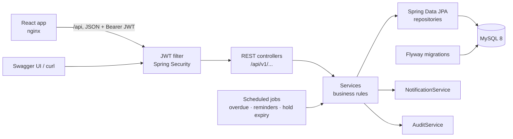
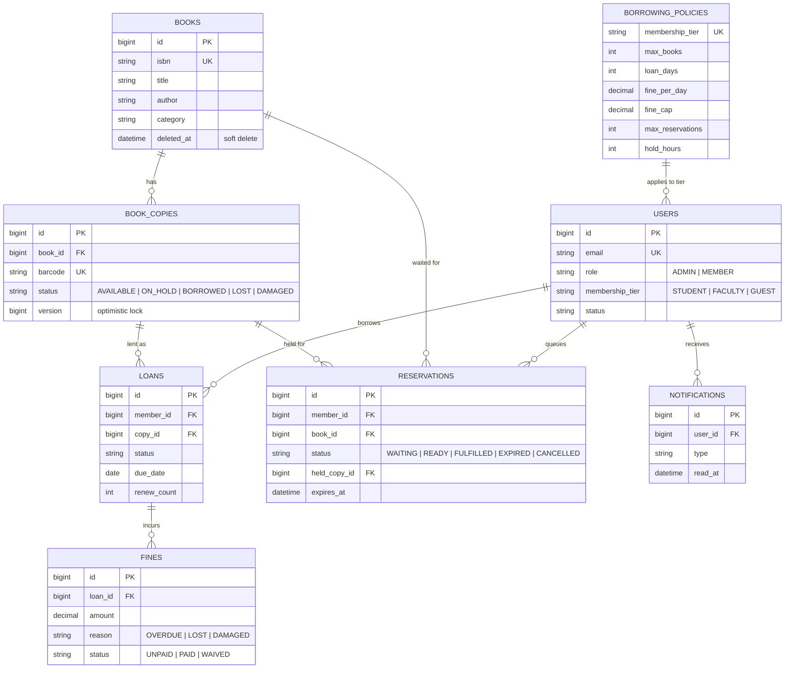

# Architecture and design

## Overview



The code is a **modular monolith**: one deployable app, with packages split by feature (`auth`, `catalog`, `circulation`, `reservation`, `fine`, `notification`, `dashboard`). Each module owns its entities, repositories, services and controllers. That keeps boundaries clear without the operational cost of microservices; a module could be extracted later if it ever needed to scale on its own.

## Highlights

- **No double booking under load.** Optimistic locking (`@Version`) on each physical copy. A test fires 10 simultaneous requests at the last copy and asserts exactly one wins.
- **Loan state machine.** `REQUESTED → APPROVED → ISSUED → OVERDUE / RETURNED / LOST`, with invalid transitions rejected in one place.
- **Rules as data.** Book limits, loan length, fine rates, renewals, reservation limits and hold time live in a `borrowing_policies` table per membership tier, so changing a rule needs no redeploy.
- **Fair waiting list.** A FIFO reservation queue with 48-hour holds. Every freed copy goes through one method, so nobody can jump the queue.
- **Background jobs.** Nightly overdue marking, de-duplicated due-tomorrow reminders, and hold expiry every 15 minutes.
- **Fine ledger.** Fines are capped per tier and can be paid or waived (waiving needs a reason). Every admin action is audited, and librarians can browse, filter and export the log.
- **Sessions you can end.** Rotating, single-use refresh tokens with reuse detection. Changing a password, a librarian reset or a suspension signs the person out everywhere at once. Sign-in is rate limited per email and IP.
- **Dashboards.** Admins see inventory, circulation, fines, the top 5 books and a 6-month trend. Members see due dates, fines, reservations and alerts.
- **Tested on both sides.** 156 backend tests (including Testcontainers integration tests against real MySQL) and 47 frontend component tests run in GitHub Actions on every push.

## Design decisions

| Decision | Why |
|---|---|
| **Book vs. copy** | A title can have many physical copies, each with its own barcode and status. Loans point at a copy, so you always know which item is where and which one is damaged or lost. |
| **Optimistic locking** on copies | Conflicts are rare, so there's no need to lock rows on every read. When two requests do race, the second fails cleanly with `409` instead of double-booking. |
| **Rules in `borrowing_policies`** | Librarians change limits, not developers. New rules arrive as Flyway migrations; V3 added reservation limits and hold time to existing tiers. |
| **One release point for copies** | `ReservationService.releaseCopy` is the only way a copy becomes free, so the waiting list can't be bypassed by any of the six code paths that free a copy. |
| **Flyway owns the schema** | Hibernate only validates (`ddl-auto: validate`). Every schema change is a reviewed, versioned SQL file. |
| **Injected `Clock`** | All date logic (due dates, fines, holds) reads time through one bean, so time-based behaviour is testable. |
| **JWT with revocation** | Short-lived access tokens (15 min) and rotating refresh tokens (7 days). No server sessions; a per-user token version lets a password change or suspension sign someone out everywhere at once. |
| **Consistent errors** | Every error, including 401/403 from the security layer, uses the same JSON shape. Bad sort fields and malformed JSON return 400, never 500. |
| **No N+1 queries** | Search pages fetch copy counts in one grouped query; loan and fine lists use entity graphs. |

## Data model



An `audit_log` table also records admin actions: who did what, to which entity, and when.

## Project structure

```
ShelfSpace/
├── backend/                 Spring Boot API (Maven)
│   ├── src/main/java/com/shelfspace/
│   │   ├── account          your profile and password
│   │   ├── audit            audit trail and the activity log API
│   │   ├── auth             register, login, JWT, refresh-token rotation, rate limits, demo data
│   │   ├── catalog          books, copies, ISBN validation, search
│   │   ├── circulation      loans, fine maths, overdue and reminder jobs
│   │   ├── dashboard        librarian and member stats
│   │   ├── fine             fine ledger: pay / waive
│   │   ├── member           users, roles, membership tiers, suspension
│   │   ├── notification     in-app alerts
│   │   ├── policy           borrowing rules per tier
│   │   ├── recommendation   "readers also borrowed"
│   │   ├── reservation      waiting list, holds, hold-expiry job
│   │   ├── wishlist         want-to-read list
│   │   └── common           security, errors, paging, clock, scheduling, field validation
│   ├── src/main/resources/db/migration   Flyway V1..V6
│   ├── src/test/java/...    unit and Testcontainers tests, same packages as the code
│   └── Dockerfile
├── frontend/                React + TypeScript web app (Vite); tests sit next to the code they test
│   ├── src/api              typed API client and endpoints
│   ├── src/auth             session and current user
│   ├── src/components       shared UI (buttons, fields, covers, layout)
│   ├── src/lib              formatting and validation helpers
│   ├── src/pages            member pages; src/pages/admin for librarian pages
│   └── src/test             test setup: fake API (MSW) and render helper
├── e2e/                     Playwright end-to-end test
├── docs/                    API, architecture, testing, deployment, development
├── docker-compose.yml       MySQL + API + web, for local runs and CI
└── .github/workflows/ci.yml backend tests, frontend tests, Docker build and end-to-end test
```

Each backend feature package holds its own entity, repository, service, controller and `dto/` package, so a feature can be read top to bottom in one place.
